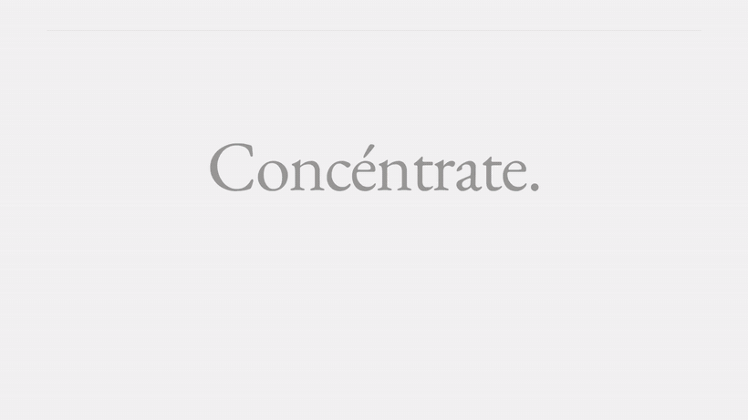
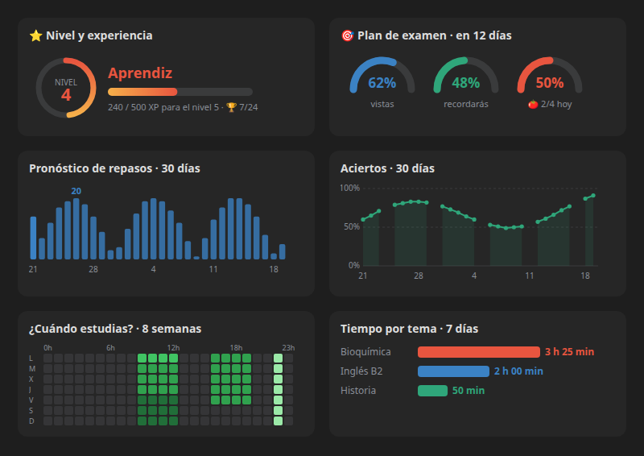
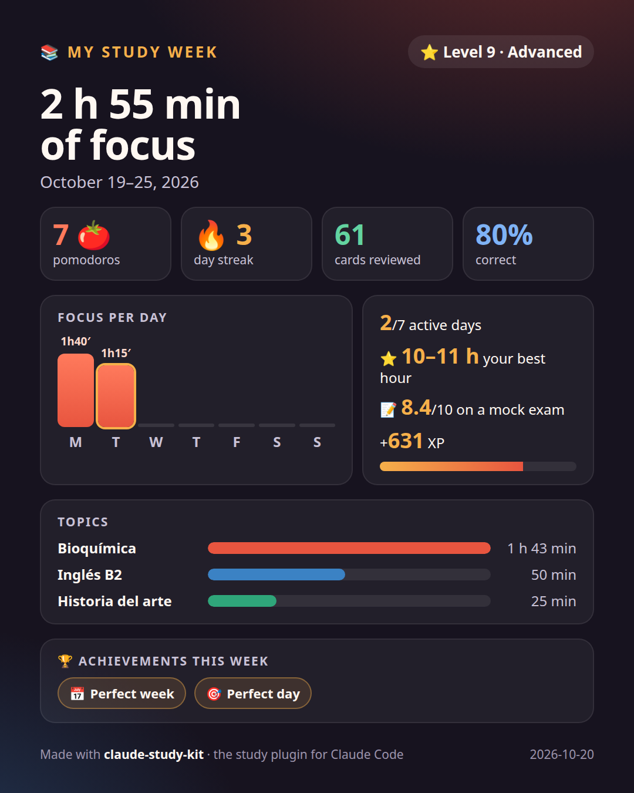
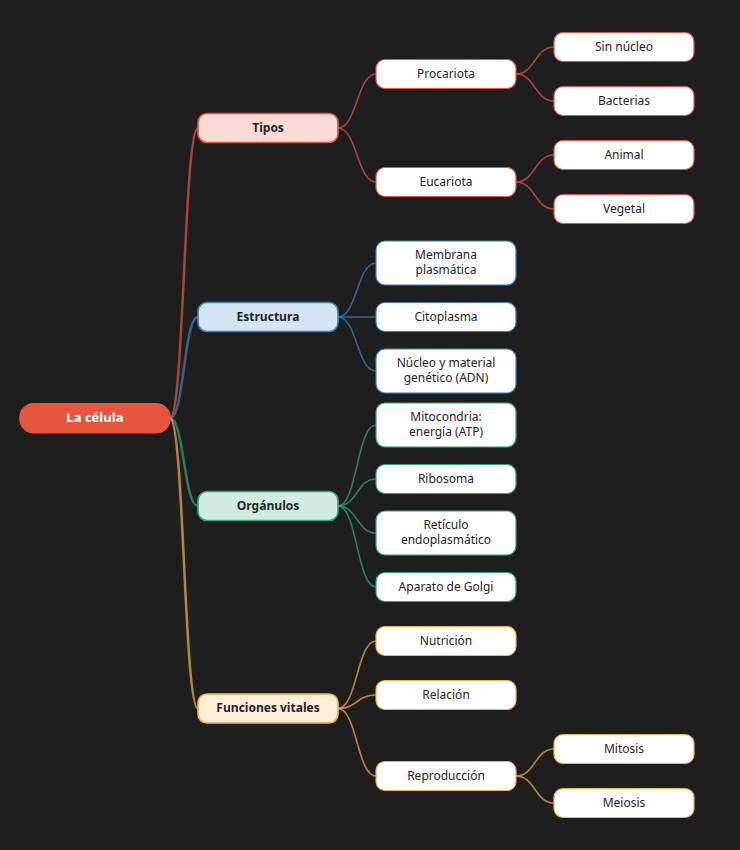
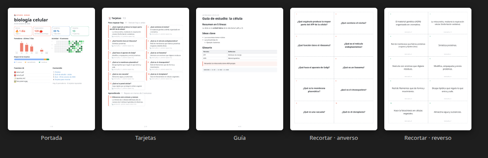
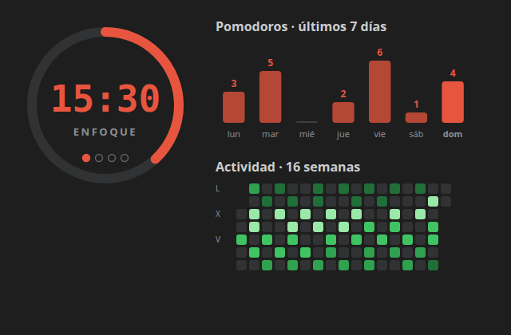

<div align="center">

# ✱ estudio

**Your study space, inside Claude Code.**
Pomodoro · spaced-repetition flashcards (FSRS) · notebooks that answer from your notes and cite the page.

[](LICENSE)
[](https://docs.claude.com/en/docs/claude-code)
[](#-development)
[](#-language)

**English** · [Español](README.md)

<a href="docs/demo.mp4"></a>

<sub>▶️ 1-minute demo (on-screen text in Spanish, ending with the switch to English) · <a href="docs/demo.mp4">watch the HD MP4</a></sub>

</div>

---

## Contents

- [Install](#-install)
- [How to use it, step by step](#-how-to-use-it-step-by-step)
- [Everything it does](#-everything-it-does)
- [Reference](#-reference): commands, skills, keys, settings, language and data
- [Requirements](#-requirements) · [Troubleshooting](#-troubleshooting) · [Development](#-development)

> **About the names.** The plugin is called *estudio* (Spanish for "study"), and its command names stay the same in both languages: *cuaderno* = notebook, *repasar* = review, *examen* = exam, *tarjetas* = cards. Arguments work in English, and the whole interface speaks English (see [Language](#-language)).

## 🚀 Install

You need [Claude Code](https://docs.claude.com/en/docs/claude-code). Inside a Claude Code session:

```
/plugin install estudio --marketplace YuthramysI/claude-study-kit
```

Answer `y` to add the marketplace and pick the user scope. You can also install it in two other ways:

- **From a shell:** `claude plugin install estudio --marketplace YuthramysI/claude-study-kit`
- **In the desktop app:** **+** next to the prompt box → **Plugins** → **Add marketplace** `YuthramysI/claude-study-kit` → **Add plugin**.

Run `/estudio help` to see every command.

## 🧭 How to use it, step by step

### 1. Make one notebook per subject

```text
/cuaderno biology
```

This creates `~/estudio/biology/`. Copy your PDFs, notes, photos or documents into **`~/estudio/biology/fuentes/`** (*fuentes* = sources). New material is detected, and the plugin offers to **✨ summarize it and make cards**.

### 2. Open the pane

```text
/estudio
```

A pane opens next to the chat with six tabs: **🍅 Pomodoro · 🃏 Review · 📚 Notebook · 🧠 Map · 📊 Stats · 🏆 Achievements**. It shows charts in VS Code and the desktop app, and draws with text characters in the terminal.

### 3. Focus with the Pomodoro

```text
/pomodoro 25 Chemistry
```

The timer runs in the status line (`🍅 24:59 · focus 1/4 · Chemistry`), and a bell rings at the end of each phase. Every 4 pomodoros you get a long break, and the time is logged under the task's topic. If you close Claude Code, the pomodoro keeps running when you come back.

### 4. Let Claude write your flashcards, then review them

```text
/estudio:tarjetas 20
/repasar
```

Claude reads your sources and writes one-idea cards, each with its source. During review:

- Press `m` to show the answer and grade it with `1`–`4` (Again · Hard · Good · Easy).
- **FSRS**, the modern Anki algorithm, decides when each card comes back.
- Press `w` to type your answer and have Claude grade it.

### 5. Ask your notes

```text
/estudio:preguntar What does the mitochondrion produce?
```

Claude answers **only from your sources** and cites every fact with its file and page: `[unit1.pdf, p. 4]`. If something isn't in them, it says so. You can also just ask in your own words: *"quiz me with 5 questions on unit 3"*.

### 6. Review in other formats

| Command | What you get |
|---|---|
| `/estudio:resumir` | A summary of each new source, plus its cards |
| `/estudio:guia` | A study guide with summary, key ideas, glossary and FAQ |
| `/estudio:mapa` | A mind map, drawn in the pane and in the PDF |
| `/estudio:quiz 10` | An interactive quiz; the questions you miss become cards |
| `/estudio:audio 5` | A podcast-style summary read aloud (`/estudio mute` stops it) |

### 7. Get ready for the exam

```text
/examen November 15 Biochemistry
/estudio:simulacro 10 15
```

- **`/examen`** sets the plan: a countdown, a daily goal for new cards and pomodoros, and a forecast of how much you'll remember on exam day.
- **`/estudio:simulacro`** is a timed mock exam built from your sources. Claude grades it out of 10, tells you your weak points, and turns each mistake into a card.

### 8. Track your progress and share it

| Command | What you get |
|---|---|
| `/estudio stats` · `/estudio achievements` | Your streak, charts and best study hours · your level and 24 achievements |
| `/estudio summary` | Your session and day, with 2–3 coach tips; saved to the journal |
| `/estudio report` | A shareable image of your week |
| `/estudio pdf` | Your whole review as a printable PDF |

## ✨ Everything it does

| | |
|---|---|
| 🍅 **Pomodoro** | The timer runs in the status line and the pane. An alarm and an alert mark the end of each phase, with a long break every 4 pomodoros. Each pomodoro has a task and adds time to its topic. It keeps running across restarts of Claude Code. |
| 🃏 **FSRS flashcards** | Claude writes them from your sources and FSRS schedules them. There's a daily new-card limit and a type-your-answer mode graded by Claude. You can edit, delete or undo the last grade. |
| 📚 **Notebooks** | Each subject gets a folder of your materials. Answers come only from your sources, with `[file, p. X]` citations. New material is detected and offered for summarizing. |
| 🧠 **Mind maps** | Claude organizes the concepts, and the plugin draws them in the pane and the PDF. |
| 📝 **Guide, quiz, audio** | A study guide with glossary and FAQ, an interactive quiz, and a podcast-style summary read aloud. |
| 📊 **Stats** | Three views: **General**, **Review** (30-day forecast, accuracy curve, difficulty) and **Habits** (an hour × weekday heatmap and your best hours). |
| 📝 **Sessions, journal, coach** | Each study stretch becomes a session, and each day gets a Markdown journal. The coach gives concrete tips based on your data. |
| 🏆 **Achievements & levels** | You earn XP, climb 8 levels (from Rookie to Legend) and can unlock 24 badges: streaks, marathon, night owl, top marks… |
| 🎯 **Exam plan** | A countdown, a daily goal, an exam-day recall forecast, and an alert if you fall behind. |
| ⏱️ **Mock exam** | Multiple-choice and short-answer questions against the clock, graded out of 10, with your score history. |
| 📸 **Weekly report** | A 1080×1350 PNG of your week. |
| 📄 **Review PDF** | A stats cover, every card, your guides, and cut-out double-sided flashcards. |
| 🔁 **Anki** | Export your cards to Anki, and import Anki decks or CSV files. |
| 🌐 **English / español** | The whole interface in your language, including Claude's replies. |
| 🛡️ **Backups** | A week of card backups, and recovery if the file gets corrupted. |

Everything stays on your machine: the plugin makes no network calls, and Claude only reads your sources when you ask it to.

<details>
<summary><b>📊 See the charts, the weekly report, the mind map and the PDF</b></summary>

<br>



 





<sub>Real plugin screenshots with sample data (some in Spanish).</sub>

</details>

<details>
<summary><b>🃏 More about review (FSRS)</b></summary>

- **FSRS** adjusts the card's *stability* (how long the memory lasts) and *difficulty* with every grade. The next review lands when the chance of recalling the card drops to 90 %, a value you can change. Each button shows when the card will come back.
- **Daily new-card limit** (20 by default): if Claude writes 50 cards at once, they come in gradually. If you have an exam plan and you're behind, the limit rises on its own.
- **⌨ Type mode** (`w`): Claude compares your answer with the right one by meaning and suggests a grade. Offline, it compares keywords.
- **Edit** (`e`), **delete** (`b`) and **undo** the last grade (`u`), without leaving the pane.
- Cards from older versions, scheduled with SM-2, are converted automatically.

</details>

<details>
<summary><b>🎯 More about the exam plan and the mock exam</b></summary>

- **Dates it understands:** `2026-11-15`, `November 15`, `Nov 15 2026`, `11/15`, `in 3 weeks`, `tomorrow`. An ambiguous date like `3/11` is read as day/month (3 November), and the reply always spells the date out.
- **Other commands:** `/examen goal 6` changes the daily pomodoro goal, and `/examen clear` removes the plan.
- **New cards are spread out** so you've seen all of them **two days before** the exam.
- **The mock exam:** `/estudio:simulacro 12 20` is 12 questions in 20 minutes, ~70 % multiple choice and ~30 % short answer. The timer runs in the status line. At the end you get a results table with citations, and the graded exam goes into the PDF.

</details>

<details>
<summary><b>📄 More about the review PDF</b></summary>

Generate it in any of these ways:

- with **`/estudio pdf`**;
- with the **📄 PDF** button (key `d`) in the Notebook tab;
- by asking Claude: *"make my review PDF"*.

It's saved to `salidas/repaso-<notebook>-<date>.pdf` and opens automatically.

| Section | Content |
|---|---|
| **Cover** | Streak, pomodoros, hours, accuracy, cards due, charts, card stages, sources and a linked table of contents |
| **Flashcards** | Every card with its answer, source and next review, grouped into *due today*, *learning* and *mature* |
| **Documents** | The guides, quizzes, maps and mock exams in `salidas/`, typeset |
| **Cut-out cards** | 10 per A4 sheet: the question on the front, the answer on the back |

**Printing the cut-out cards:**

1. Print **double-sided, flipping on the long edge, at 100 %**. Each answer then lands right behind its question.
2. Cut along the dashed lines.

</details>

## 📖 Reference

<details>
<summary><b>Commands</b></summary>

| Command | What it does |
|---|---|
| `/estudio [pomodoro\|review\|notebook\|map\|stats\|achievements]` | Opens the pane on that tab (a prefix works too: `/estudio rev`) |
| `/estudio pdf` | Review PDF of the active notebook |
| `/estudio summary` | Your session and day, with coach tips; updates the journal |
| `/estudio report [last]` | This week's (or last week's) PNG, in `~/estudio/informes/` |
| `/estudio mute` · `/estudio help` | Stops the voice · shows the help |
| `/pomodoro` | Starts a pomodoro, or says how much is left if one is running |
| `/pomodoro 50 [task]` · `/pomodoro task <text>` | A 50-minute focus with a task · changes the task |
| `/pomodoro pause\|resume\|skip\|stop\|status` | Timer controls (`/promodoro` works too) |
| `/pomodoro test` | Tests the alarm and the alerts |
| `/cuaderno` · `/cuaderno <name>` | Lists notebooks · creates or activates one |
| `/repasar` | Reviews the cards due today |
| `/examen <date> [title]` · `/examen` · `/examen goal <n>` · `/examen clear` | Sets the exam plan · shows its status · changes the daily goal · removes it |
| `/anki` · `/anki export` · `/anki import <file>` | Card summary · export to Anki · import from Anki (tab-separated text), CSV or `front :: back` lines |

</details>

<details>
<summary><b>Skills (Claude works with your sources)</b></summary>

| Skill | What it does |
|---|---|
| `/estudio:preguntar <question>` | *ask*: cited answer from your sources; with no question, summarizes the notebook |
| `/estudio:resumir [files]` | *summarize*: one summary per source (the new ones by default), plus its cards |
| `/estudio:tarjetas [n] [topic]` | *cards*: one-idea flashcards, each with its source |
| `/estudio:guia [topic]` | *guide*: full study guide with summary, key ideas, glossary and FAQ |
| `/estudio:mapa [topic]` | *map*: mind map in `salidas/mapa-*.md` |
| `/estudio:quiz [n] [topic]` | Multiple-choice quiz, one question at a time |
| `/estudio:simulacro [n] [min] [topic]` | *mock exam*: timed, graded out of 10 |
| `/estudio:audio [min] [topic]` | Podcast-style summary read aloud |

</details>

<details>
<summary><b>Pane keys</b></summary>

| Tab | Keys |
|---|---|
| 🍅 Pomodoro | `i` start · `p` pause/resume · `s` skip phase · `x` stop · `t` change task |
| 🃏 Review | `m` show answer · `1`–`4` grade · `w` type mode · `e` edit · `b` delete · `u` undo |
| 📚 Notebook | `t` cards · `g` guide · `q` quiz · `x` mock exam · `a` audio · `d` PDF · `e` set exam · `r` reload · `n` summarize new sources · `i` ignore them |
| 🧠 Map | `n` new mind map |
| 📊 Stats | `g` general · `r` review · `h` habits · `i` weekly report · `c` coach tip |

</details>

<details>
<summary><b>Settings</b> (<code>/config</code> → <b>estudio</b>)</summary>

| Option | Default |
|---|---|
| Idioma / Language | `auto` (system language) · `es` · `en` |
| Study folder | `~/estudio` |
| Focus / break / long break minutes | 25 / 5 / 15 |
| Alarm at the end · rings · volume | on · 3 · 80 |
| Auto-start the next pomodoro | off |
| New cards per day | 20 |
| Desired retention (FSRS) | 90 % |
| Remind me of due cards when a session opens | on |

</details>

### 🌐 Language

The whole plugin speaks **English or Spanish**, and the skills reply and write their files in the chosen language. Quotes from your sources stay as they are. That covers:

- the pane and command replies;
- alerts and the voice;
- achievements;
- the PDF and the weekly report.

- **`auto`** (default): uses `LANGUAGE`, `LC_ALL` or `LANG`. Spanish if they start with `es`, English otherwise.
- **`es`** or **`en`**: fixes the language.

<details>
<summary><b>Where your data lives</b></summary>

```
~/estudio/
├── biology/
│   ├── fuentes/            ← your materials: pdf, md, txt, html, docx, images…
│   ├── salidas/            ← guides, quizzes, maps, summaries, review PDF, Anki exports
│   ├── tarjetas.json       ← your cards (editable by hand)
│   ├── tarjetas.bak.json   ← the previous version
│   ├── plan.json           ← your exam plan
│   └── .respaldos/         ← one backup per weekday
├── diario/2026-10-20.md    ← each day's journal
└── informes/semana-2026-10-19.png
```

To add a card by hand, `{"frente": "...", "reverso": "..."}` is enough (*frente* = front, *reverso* = back); the plugin fills in the rest.

</details>

## 🔧 Requirements

- **[Claude Code](https://docs.claude.com/en/docs/claude-code)**, tested with version 2.1.304.
- **Sound and voice:** on macOS they work out of the box. On Linux, the alarm uses `paplay` and the voice uses `spd-say`:
  ```bash
  sudo apt install speech-dispatcher espeak-ng
  ```
- **PDF and report:** they need Chrome, Chromium, Edge or Brave (run without opening a window). Without one, the plugin leaves an `.html` for you to print to PDF with *background graphics* on.

## ❓ Troubleshooting

| Symptom | Fix |
|---|---|
| The Pomodoro makes no sound or alert | Run `/pomodoro test`: it reports what works (sound, alert, timer). On Linux, install `paplay` (PulseAudio or PipeWire). |
| I can't see the pane | Run `/estudio`. In VS Code it opens next to the chat. |
| Claude can't find my notes | Check with `/cuaderno` that the right notebook is active and that your files are in its `fuentes/` folder. |
| The interface is in the wrong language | Go to `/config` → **estudio** → *Idioma / Language* and pick `en` or `es`. |

## 🔨 Development

```bash
git clone https://github.com/YuthramysI/claude-study-kit && cd claude-study-kit
claude --plugin-dir .         # Claude Code with this folder's plugin loaded
claude plugin validate .      # manifest and hooks
claude plugin test .          # 100 tests
```

Contributions are welcome: see [CONTRIBUTING.md](CONTRIBUTING.md) (in Spanish) and [CHANGELOG.md](CHANGELOG.md).

## 📄 License

[MIT](LICENSE) © Yuthramys Ibarra
