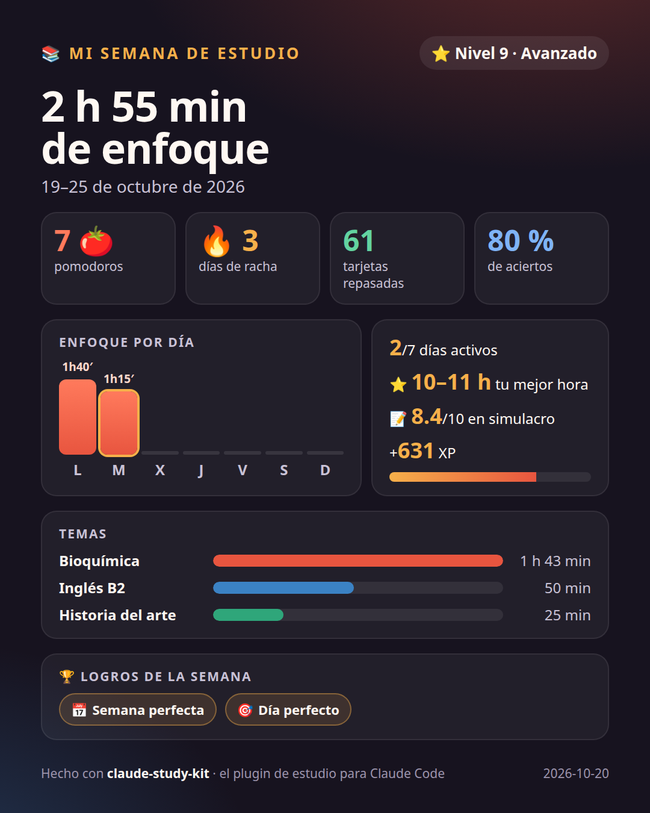

<div align="center">

# ✱ estudio

**Tu espacio de estudio, dentro de Claude Code.**
Pomodoro · tarjetas con repaso espaciado (FSRS) · cuadernos que responden con tus apuntes y citan la página.

[](LICENSE)
[](https://docs.claude.com/en/docs/claude-code)
[](#-desarrollo)
[](#-idioma--language)

**Español** · [English](README.en.md)

<a href="docs/demo.mp4"></a>

<sub>▶️ Demo de 1 minuto · <a href="docs/demo.mp4">ver en MP4 (HD)</a></sub>

</div>

---

## Contenido

- [Instalación](#-instalación)
- [Cómo se usa, paso a paso](#-cómo-se-usa-paso-a-paso)
- [Todo lo que hace](#-todo-lo-que-hace)
- [Referencia](#-referencia): comandos, skills, teclas, configuración, idioma y datos
- [Requisitos](#-requisitos) · [Problemas frecuentes](#-problemas-frecuentes) · [Desarrollo](#-desarrollo)

## 🚀 Instalación

Necesitas [Claude Code](https://docs.claude.com/en/docs/claude-code). Dentro de una sesión de Claude Code:

```
/plugin install estudio --marketplace YuthramysI/claude-study-kit
```

Responde `y` para añadir el marketplace y elige el ámbito de usuario. También puedes instalarlo de estas dos formas:

- **Desde una shell:** `claude plugin install estudio --marketplace YuthramysI/claude-study-kit`
- **En la app de escritorio:** **+** junto al cuadro de texto → **Plugins** → **Add marketplace** `YuthramysI/claude-study-kit` → **Add plugin**.

Escribe `/estudio ayuda` para ver todos los comandos.

## 🧭 Cómo se usa, paso a paso

### 1. Crea un cuaderno por asignatura

```text
/cuaderno biologia
```

Se crea `~/estudio/biologia/`. Copia tus PDFs, apuntes, fotos o documentos en **`~/estudio/biologia/fuentes/`**. El plugin detecta el material nuevo y te ofrece **✨ Resumir y crear tarjetas**.

### 2. Abre el panel

```text
/estudio
```

Se abre un panel junto al chat con seis pestañas: **🍅 Pomodoro · 🃏 Repaso · 📚 Cuaderno · 🧠 Mapa · 📊 Stats · 🏆 Logros**. En VS Code y en la app de escritorio tiene gráficos; en la terminal se dibuja con caracteres.

### 3. Concéntrate con el Pomodoro

```text
/pomodoro 25 Química
```

El reloj corre en la barra de estado (`🍅 24:59 · enfoque 1/4 · Química`) y suena una campana al terminar cada fase. Cada 4 pomodoros toca un descanso largo, y el tiempo se apunta en el tema de la tarea. Si cierras Claude Code, el pomodoro sigue en marcha cuando vuelves.

### 4. Deja que Claude cree tus tarjetas y repásalas

```text
/estudio:tarjetas 20
/repasar
```

Claude lee tus fuentes y crea tarjetas de una idea cada una, con su fuente. En el repaso:

- Pulsa `m` para ver la respuesta y califícala con `1`–`4` (Otra vez · Difícil · Bien · Fácil).
- **FSRS**, el algoritmo moderno de Anki, decide cuándo vuelve cada tarjeta.
- Con `w` escribes tu respuesta y Claude la corrige.

### 5. Pregunta a tus apuntes

```text
/estudio:preguntar ¿Qué produce la mitocondria?
```

Claude responde **solo con tus fuentes** y cita cada dato con su archivo y página: `[tema1.pdf, p. 4]`. Si algo no está en ellas, te lo dice. También puedes pedírselo con tus palabras: *«hazme un quiz de 5 preguntas sobre el tema 3»*.

### 6. Repasa con otros formatos

| Comando | Qué obtienes |
|---|---|
| `/estudio:resumir` | Un resumen de cada fuente nueva y sus tarjetas |
| `/estudio:guia` | Una guía de estudio con resumen, ideas clave, glosario y FAQ |
| `/estudio:mapa` | Un mapa mental, dibujado en el panel y en el PDF |
| `/estudio:quiz 10` | Un quiz interactivo; las preguntas que falles se convierten en tarjetas |
| `/estudio:audio 5` | Un resumen tipo podcast leído en voz alta (`/estudio callar` lo para) |

### 7. Prepara el examen

```text
/examen 15/11 Bioquímica
/estudio:simulacro 10 15
```

- **`/examen`** activa el plan: una cuenta atrás, la meta diaria de tarjetas y pomodoros, y una previsión de cuánto recordarás ese día.
- **`/estudio:simulacro`** es un examen cronometrado sacado de tus fuentes. Claude lo corrige con nota sobre 10, te dice tus puntos débiles y convierte cada fallo en una tarjeta.

### 8. Mira tu progreso y compártelo

| Comando | Qué obtienes |
|---|---|
| `/estudio stats` · `/estudio logros` | Tu racha, tus gráficos y a qué horas rindes más · tu nivel y tus 24 logros |
| `/estudio resumen` | Tu sesión y tu día, con 2–3 consejos del coach; se guarda en el diario |
| `/estudio informe` | Una imagen de tu semana lista para compartir |
| `/estudio pdf` | Todo tu repaso en un PDF para imprimir |

## ✨ Todo lo que hace

| | |
|---|---|
| 🍅 **Pomodoro** | El reloj va en la barra de estado y en el panel. Al terminar cada fase suena la alarma y llega un aviso; cada 4 pomodoros toca un descanso largo. Cada pomodoro lleva una tarea y suma tiempo a su tema. Sigue en marcha aunque reinicies Claude Code. |
| 🃏 **Tarjetas FSRS** | Claude las crea a partir de tus fuentes y FSRS las programa. Hay un límite diario de tarjetas nuevas y un modo de escribir la respuesta para que Claude la corrija. Puedes editar, borrar o deshacer la última nota. |
| 📚 **Cuadernos** | Cada asignatura tiene una carpeta con tus materiales. Las respuestas salen solo de tus fuentes, con citas `[archivo, p. X]`. El plugin detecta el material nuevo y te ofrece resumirlo. |
| 🧠 **Mapas mentales** | Claude ordena los conceptos y el plugin los dibuja en el panel y en el PDF. |
| 📝 **Guía, quiz y audio** | Guía con glosario y FAQ, quiz interactivo y resumen tipo podcast en voz alta. |
| 📊 **Estadísticas** | Tres vistas: **General**, **Repaso** (pronóstico a 30 días, curva de aciertos, dificultad) y **Hábitos** (a qué hora y qué día estudias, tus mejores horas). |
| 📝 **Sesiones, diario y coach** | Cada tramo de estudio queda como sesión y cada día tiene su diario en Markdown. El coach te da consejos concretos con tus datos. |
| 🏆 **Logros y niveles** | Ganas XP, subes por 8 niveles (de Novato a Leyenda) y puedes conseguir 24 insignias: rachas, maratón, búho nocturno, sobresaliente… |
| 🎯 **Plan de examen** | Cuenta atrás, meta diaria, previsión de recuerdo el día del examen y aviso si vas atrasado. |
| ⏱️ **Examen simulado** | Preguntas tipo test y de desarrollo, con cronómetro. Nota sobre 10 y evolución de tus notas. |
| 📸 **Informe semanal** | Una imagen PNG de 1080×1350 con tu semana. |
| 📄 **PDF de repaso** | Portada con estadísticas, todas tus tarjetas, tus guías y tarjetas para recortar a doble cara. |
| 🔁 **Anki** | Exporta tus tarjetas a Anki e importa mazos de Anki o archivos CSV. |
| 🌐 **Español / English** | Toda la interfaz en tu idioma, incluidas las respuestas de Claude. |
| 🛡️ **Copias de seguridad** | Una semana de copias de tus tarjetas, y recuperación si el archivo se daña. |

Todo se queda en tu equipo: el plugin no usa la red, y Claude solo lee tus fuentes cuando se lo pides.

<details>
<summary><b>📊 Ver los gráficos, el informe semanal, el mapa y el PDF</b></summary>

<br>


 


<sub>Capturas reales del plugin con datos de ejemplo.</sub>

</details>

<details>
<summary><b>🃏 Más sobre el repaso (FSRS)</b></summary>

- **FSRS** ajusta con cada nota la *estabilidad* (cuánto aguanta el recuerdo) y la *dificultad* de la tarjeta. El siguiente repaso cae cuando la probabilidad de recordarla baja al 90 %, un valor que puedes cambiar. Junto a cada botón ves cuándo volverá la tarjeta.
- **Límite diario de nuevas** (20 por defecto): si Claude crea 50 tarjetas de golpe, entran poco a poco. Si tienes un plan de examen y no llegas a tiempo, el límite sube solo.
- **⌨ Modo escribir** (`w`): Claude compara tu respuesta con la correcta por su significado y te sugiere la nota. Sin conexión, compara palabras clave.
- **Editar** (`e`), **borrar** (`b`) y **deshacer** la última nota (`u`), sin salir del panel.
- Las tarjetas de versiones anteriores, programadas con SM-2, se convierten solas.

</details>

<details>
<summary><b>🎯 Más sobre el plan de examen y el simulacro</b></summary>

```text
/examen 15/11 Final de Bioquímica
🎯 Final de Bioquímica: 15 de noviembre de 2026 (en 26 días)
  📚 vistas 40 % · 60 nuevas por empezar (3/día)
  🧠 previsión de recuerdo el día del examen: 34 %
  🍅 hoy 1/4 pomodoros
  👉 Hoy te faltan 2 tarjetas nuevas y 3 🍅.
```

- **Fechas que entiende:** `15/11`, `2026-11-15`, «15 de noviembre», «en 20 días», «mañana».
- **Otras órdenes:** `/examen meta 6` cambia la meta diaria de pomodoros y `/examen borrar` quita el plan.
- **El reparto de tarjetas nuevas** está pensado para que las hayas visto todas **dos días antes** del examen.
- **El simulacro:** `/estudio:simulacro 12 20` son 12 preguntas en 20 minutos, ~70 % tipo test y ~30 % de desarrollo. El cronómetro va en la barra de estado. Al final ves una tabla de aciertos y fallos con citas, y el examen corregido entra en el PDF.

</details>

<details>
<summary><b>📄 Más sobre el PDF de repaso</b></summary>

Genéralo de cualquiera de estas formas:

- con **`/estudio pdf`**;
- con el botón **📄 PDF** (tecla `d`) de la pestaña Cuaderno;
- pidiéndoselo a Claude: *«hazme el PDF de repaso»*.

Se guarda en `salidas/repaso-<cuaderno>-<fecha>.pdf` y se abre solo.

| Sección | Contenido |
|---|---|
| **Portada** | Racha, pomodoros, horas, aciertos, tarjetas de hoy, gráficos, etapas, fuentes e índice con enlaces |
| **Tarjetas** | Todas, con su respuesta, su fuente y su próximo repaso, agrupadas en *hoy*, *aprendiendo* y *maduras* |
| **Documentos** | Las guías, quizzes, mapas y simulacros de `salidas/`, maquetados |
| **Para recortar** | 10 tarjetas por hoja A4: la pregunta en el anverso y la respuesta en el reverso |

**Imprimir las tarjetas para recortar:**

1. Imprime **a doble cara, girando por el borde largo, al 100 %**. Así cada respuesta queda detrás de su pregunta.
2. Recorta por las líneas discontinuas.

> 💡 Genera antes `/estudio:guia` y `/estudio:quiz` para que el PDF sea un dosier completo.

</details>

## 📖 Referencia

<details>
<summary><b>Comandos</b></summary>

| Comando | Qué hace |
|---|---|
| `/estudio [pomodoro\|repaso\|cuaderno\|mapa\|stats\|logros]` | Abre el panel en esa pestaña |
| `/estudio pdf` | PDF de repaso del cuaderno activo |
| `/estudio resumen` | Tu sesión y tu día, con consejos del coach; actualiza el diario |
| `/estudio informe [pasada]` | Imagen de la semana actual o de la pasada, en `~/estudio/informes/` |
| `/estudio callar` · `/estudio ayuda` | Detiene la voz · muestra la ayuda |
| `/pomodoro` | Inicia el pomodoro, o dice cuánto queda si ya está en marcha |
| `/pomodoro 50 [tarea]` · `/pomodoro tarea <texto>` | Un enfoque de 50 min con su tarea · cambia la tarea |
| `/pomodoro pausar\|reanudar\|saltar\|parar\|estado` | Controla el temporizador (también vale `/promodoro`) |
| `/pomodoro probar` | Prueba la alarma y los avisos |
| `/cuaderno` · `/cuaderno <nombre>` | Lista los cuadernos · crea o activa uno |
| `/repasar` | Repasa las tarjetas pendientes |
| `/examen <fecha> [título]` · `/examen` · `/examen meta <n>` · `/examen borrar` | Fija el plan de examen · muestra su estado · cambia la meta diaria · lo quita |
| `/anki` · `/anki exportar` · `/anki importar <archivo>` | Resumen de tus tarjetas · exporta a Anki · importa de Anki (texto con tabuladores), CSV o líneas `frente :: reverso` |

</details>

<details>
<summary><b>Skills (Claude trabaja con tus fuentes)</b></summary>

| Skill | Qué hace |
|---|---|
| `/estudio:preguntar <pregunta>` | Responde con citas de tus fuentes; sin pregunta, resume el cuaderno |
| `/estudio:resumir [archivos]` | Resume cada fuente (por defecto, las nuevas) en `salidas/resumen-*.md` y crea sus tarjetas |
| `/estudio:tarjetas [n] [tema]` | Crea tarjetas de una idea cada una, con su fuente |
| `/estudio:guia [tema]` | Guía completa con resumen, ideas clave, glosario y FAQ |
| `/estudio:mapa [tema]` | Mapa mental en `salidas/mapa-*.md` |
| `/estudio:quiz [n] [tema]` | Quiz de opción múltiple, una pregunta a la vez |
| `/estudio:simulacro [n] [min] [tema]` | Examen cronometrado con nota sobre 10 |
| `/estudio:audio [min] [tema]` | Resumen tipo podcast leído en voz alta |

</details>

<details>
<summary><b>Teclas del panel</b></summary>

| Pestaña | Teclas |
|---|---|
| 🍅 Pomodoro | `i` iniciar · `p` pausar/reanudar · `s` saltar fase · `x` parar · `t` cambiar la tarea |
| 🃏 Repaso | `m` mostrar respuesta · `1`–`4` calificar · `w` modo escribir · `e` editar · `b` borrar · `u` deshacer |
| 📚 Cuaderno | `t` tarjetas · `g` guía · `q` quiz · `x` simulacro · `a` audio · `d` PDF · `e` fijar examen · `r` recargar · `n` resumir fuentes nuevas · `i` ignorarlas |
| 🧠 Mapa | `n` nuevo mapa mental |
| 📊 Stats | `g` general · `r` repaso · `h` hábitos · `i` informe semanal · `c` consejo del coach |

</details>

<details>
<summary><b>Configuración</b> (<code>/config</code> → <b>estudio</b>)</summary>

| Opción | Por defecto |
|---|---|
| Idioma / Language | `auto` (el del sistema) · `es` · `en` |
| Carpeta de estudio | `~/estudio` |
| Minutos de enfoque / descanso / descanso largo | 25 / 5 / 15 |
| Alarma al terminar · toques · volumen | sí · 3 · 80 |
| Iniciar solo el siguiente pomodoro | no |
| Tarjetas nuevas por día | 20 |
| Retención deseada (FSRS) | 90 % |
| Recordar las tarjetas pendientes al abrir sesión | sí |

</details>

### 🌐 Idioma / Language

El plugin funciona entero en **español o inglés**, y las skills responden y escriben sus archivos en el idioma elegido:

- el panel y las respuestas de los comandos;
- los avisos y la voz;
- los logros;
- el PDF y el informe.

- **`auto`** (por defecto): usa `LANGUAGE`, `LC_ALL` o `LANG`. Si empiezan por `es`, español; si no, inglés.
- **`es`** o **`en`**: fija el idioma.

Los comandos se llaman igual en los dos idiomas y entienden argumentos en inglés:

- `/pomodoro start|pause|resume|skip|stop|status|task`
- `/estudio review|notebook|map|achievements|summary|report [last]|mute|help`
- `/anki export|import`
- `/examen goal|clear`, con fechas como «November 15» o «in 20 days»

<details>
<summary><b>Dónde se guardan tus datos</b></summary>

```
~/estudio/
├── biologia/
│   ├── fuentes/            ← tus materiales: pdf, md, txt, html, docx, imágenes…
│   ├── salidas/            ← guías, quizzes, mapas, resúmenes, PDF de repaso, exportaciones de Anki
│   ├── tarjetas.json       ← tus tarjetas (se pueden editar a mano)
│   ├── tarjetas.bak.json   ← la versión anterior
│   ├── plan.json           ← tu plan de examen
│   └── .respaldos/         ← una copia por día de la semana
├── diario/2026-10-20.md    ← el diario de cada día
└── informes/semana-2026-10-19.png
```

Para añadir una tarjeta a mano basta con `{"frente": "...", "reverso": "..."}`; el plugin completa el resto.

</details>

## 🔧 Requisitos

- **[Claude Code](https://docs.claude.com/en/docs/claude-code)**, probado con la versión 2.1.304.
- **Sonido y voz:** en macOS funcionan sin instalar nada. En Linux, la alarma usa `paplay` y la voz `spd-say`:
  ```bash
  sudo apt install speech-dispatcher espeak-ng
  ```
- **PDF e informe:** necesitan Chrome, Chromium, Edge o Brave (se usan sin abrir ventana). Si no tienes ninguno, el plugin deja un `.html` para que lo imprimas tú como PDF, con *gráficos de fondo* activado.

## ❓ Problemas frecuentes

| Síntoma | Solución |
|---|---|
| El Pomodoro no suena ni avisa | Ejecuta `/pomodoro probar`: te dice qué funciona (sonido, aviso, temporizador). En Linux, instala `paplay` (PulseAudio o PipeWire). |
| No veo el panel | Ejecuta `/estudio`. En VS Code se abre al lado del chat. |
| Claude no encuentra mis apuntes | Comprueba con `/cuaderno` que el cuaderno activo es el correcto y que tus archivos están en su carpeta `fuentes/`. |
| La interfaz sale en otro idioma | Ve a `/config` → **estudio** → *Idioma / Language* y elige `es` o `en`. |

## 🔨 Desarrollo

```bash
git clone https://github.com/YuthramysI/claude-study-kit && cd claude-study-kit
claude --plugin-dir .         # Claude Code con el plugin cargado desde esta carpeta
claude plugin validate .      # manifiesto y hooks
claude plugin test .          # 100 tests
```

<details>
<summary><b>Estructura del código</b></summary>

| Archivo | Contenido |
|---|---|
| `hooks/register.tsx` | Comandos, herramientas y arranque |
| `hooks/panel.tsx` · `graficos.ts` | El panel con sus 6 pestañas y los gráficos SVG |
| `hooks/acciones.ts` | Pomodoro, cuadernos, tarjetas, estadísticas, PDF, voz |
| `hooks/srs.ts` · `pomodoro.ts` · `stats.ts` · `anki.ts` · `mapa.ts` | Lógica pura (con tests): FSRS, temporizador, estadísticas, Anki, mapas |
| `hooks/sesiones.ts` · `logros.ts` · `plan.ts` · `informe.ts` · `pdf.ts` | Sesiones y diario, logros, plan de examen, informe semanal, PDF |
| `hooks/cuadernos.ts` · `motor.ts` · `i18n.ts` | Archivos y copias, enlace con el motor, idioma (`L('español', 'English')`) |
| `skills/*/SKILL.md` | preguntar, resumir, tarjetas, guía, mapa, quiz, simulacro, audio |

</details>

Las contribuciones son bienvenidas: lee [CONTRIBUTING.md](CONTRIBUTING.md) y [CHANGELOG.md](CHANGELOG.md).

## 📄 Licencia

[MIT](LICENSE) © Yuthramys Ibarra
